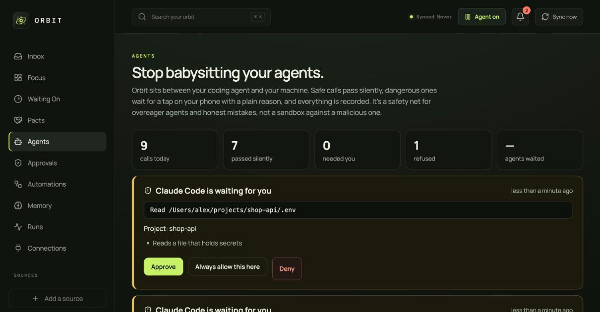
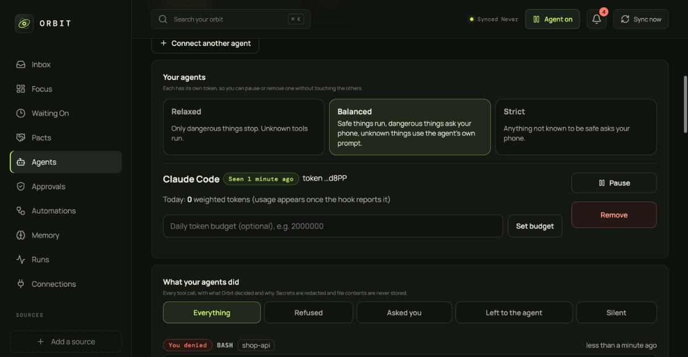
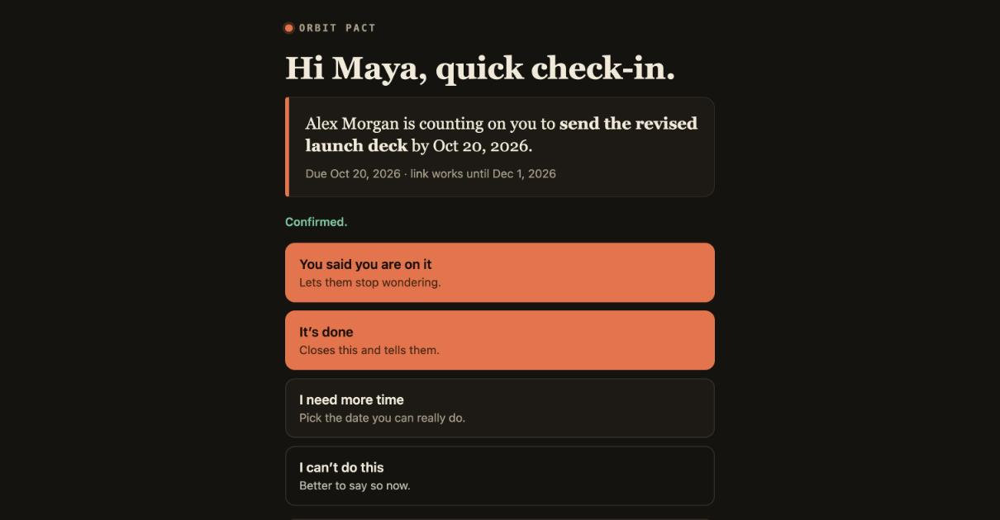
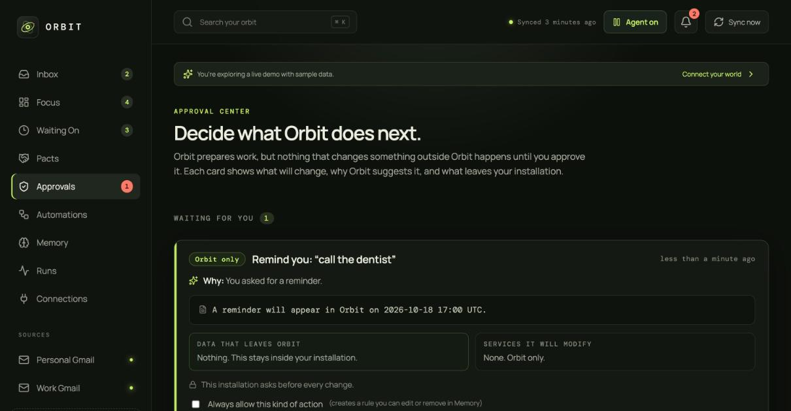

<picture>
  <source media="(prefers-color-scheme: dark)" srcset="public/brand/orbit-lockup-dark.svg">
  
</picture>

# Orbit — stop babysitting your AI agents

**Your coding agent asks "can I run this?" a hundred times a day, so you stop reading and click Yes. Orbit sits between the agent and your machine: safe calls pass silently, dangerous ones wait for one tap on your phone with a plain-English reason, and everything is recorded. Self-hosted, open source, two minutes to connect.**

[](LICENSE)
[](#install-it-in-your-own-cloud)
[](#how-its-built)
[](#safety-you-can-verify)

<p align="center">
  
</p>

> **Nothing here runs on my servers.** Orbit is a project you deploy to Railway, a $5 VPS, or `docker compose` on any machine. One person, one install, one database that only you own.

---

## Orbit Guard: a permission layer for coding agents

Developers using Claude Code and similar agents hit the same wall: approve everything and stop paying attention, or turn the prompts off and hope. Orbit replaces both with a policy.

| The agent wants to… | Orbit does |
| --- | --- |
| `git status`, `npm test`, read or edit a file in the project | **Lets it through silently.** No prompt, no waiting. |
| `git push --force origin main`, `rm -rf dist`, `vercel --prod`, read `.env`, `curl -d … https://outside` | **Buzzes your phone** with the exact command, the project, and why it's risky. *Approve · Always allow this here · Deny*. |
| `rm -rf /`, format a disk, a fork bomb | **Refuses.** No rule can override it. |
| Something it doesn't recognise | Depends on your strictness: hand back to the agent's own prompt (default), run it, or ask your phone. |

On top of that:

- **Budgets.** Cap an agent's daily token use; it is stopped before the bill surprises you. Optional dollar view.
- **A flight recorder.** A readable log of every call and why Orbit decided what it did, with secrets redacted and file contents never stored.
- **An evening summary.** *"214 tool calls: 198 passed silently, 14 needed you, 2 refused. You were asked about `git push` 6 times."* That last line is how you tune your rules.
- **Your own rules**, with a **"What would Orbit do?"** box so you can test a command without running it.
- **Fails safe.** If Orbit is unreachable, Claude Code simply asks you itself. An outage never becomes "allow".

<p align="center">
  
</p>

**Try the judge in your browser first:** every Orbit serves a public playground at `/playground.html` (or run `npm run dev` and open <http://localhost:5173/playground.html>). Type a command, pick a strictness, and see whether it passes, asks your phone, or is refused, with a breakdown of how it was read. It runs entirely client-side, and each result has a shareable link.

### Connect Claude Code in two minutes

1. In Orbit open **Agents**, name your agent, and copy the token (shown once).
2. On your machine:

   ```bash
   mkdir -p ~/.orbit && curl -fsSL https://YOUR-ORBIT/guard/hook.mjs -o ~/.orbit/orbit-guard.mjs
   export ORBIT_URL=https://YOUR-ORBIT ORBIT_GUARD_TOKEN=og_...
   ```

3. Add one `PreToolUse` hook to `~/.claude/settings.json` (Orbit shows the exact JSON).
4. Link Telegram in **Connections → Set up Orbit** so approvals reach your phone.

It's a safety net for overeager agents and honest mistakes, **not a sandbox**: a determined malicious process can get around any command filter, so run untrusted agents in a container too. Details, limits and the full list of what it stops: **[docs/GUARD.md](docs/GUARD.md)**.

---

## And the rest of Orbit: promises between people

The same approval-first engine runs a personal operations agent: it reads your mail, tracks who owes what, and drafts the follow-ups. Its best idea is the **pact**.

### The idea: pacts

Every personal-agent demo ends the same way: *it did a thing for me.* But most of what slips through the cracks isn't a task. It's a **promise between two people**:

- “I'll send you the revised deck Friday.” *(then nobody checks)*
- “Can you review this by Monday?” *(then you forget you said yes)*

So Orbit makes the promise itself a first-class object. Say it in chat, in Waiting On, or in Telegram, and Orbit turns it into a **pact**:

1. Orbit creates a private link and a ready-to-paste message. **It sends nothing; you do.**
2. The other person opens the link: **no account, no app, no install**. One tap: *I'm on it · It's done · I need more time · I can't do this.*
3. Orbit updates your Waiting On list, stops nagging when it's done, and pings you (in the app, and on Telegram).

<p align="center">
  
</p>

That page is also how Orbit **reaches people**. Everyone you send a pact to sees a one-tap tracker and a link to run their own. And if your friend already runs Orbit, the two installs can exchange pacts directly: **signed messages, explicit two-way trust, no accounts, no middleman server.**

It's a tiny protocol for keeping your word, with an agent that does the remembering.

## Try it in two minutes

```bash
git clone https://github.com/advaidg/orbit-personal-cockpit.git
cd orbit-personal-cockpit
npm install
DEMO_MODE=true npm run dev       # sample data, clearly labelled, nothing connected
```

Open <http://localhost:5173>. Go to **Agents → Connect an agent**, then try the **What would Orbit do?** box with `git push --force` and `git status`. Or go to **Pacts → Make a pact**, copy the link into another browser tab, and answer as the other person.

To see Guard end to end locally, create an agent, then ask it a question yourself:

```bash
curl -s localhost:3000/guard/v1/hook -H "Authorization: Bearer $TOKEN" -H 'Content-Type: application/json' \
  -d '{"hook_event_name":"PreToolUse","cwd":"/tmp/app","tool_name":"Bash","tool_input":{"command":"git push --force origin main"}}'
# the request waits, a card appears on the Agents page; approve it and the curl returns the allow decision
```

## What you get

| | |
| --- | --- |
| **Agent Guard** | Permission layer for coding agents: silent for safe, phone approval for risky, budgets, audit log, evening summary. |
| **Pacts** | Private one-tap links; replies update Waiting On; Orbit-to-Orbit sharing between installs. |
| **Waiting On** | Finds promises and requests in your Gmail with deterministic rules (not vibes), suggests when to follow up, and drafts the nudge. |
| **Approval Center** | Every action Orbit proposes shows *what changes, why, and what leaves your install*, and waits for you. Edit it, approve it, reject it, or undo it. |
| **Telegram** | Chat with Orbit and approve or reject proposals with buttons, from your phone. Same approval rules as the web app. |
| **Gmail drafts** | Writes reply drafts into your Drafts folder. You read, edit and send them yourself. |
| **Calendar** | Finds conflicts, adds preparation tasks, creates events only after you approve each one. |
| **Transparent memory** | Everything Orbit “learns” is a plain sentence you can read, edit or delete: *“Messages from maya@… are high priority.”* |
| **Automations** | Eight ready recipes (morning brief, bills due, no-reply follow-ups…) with dry-run, per-day limits and a kill switch. |
| **Ask Orbit** | Natural-language requests become typed tool calls, never free-form actions. Works with no AI provider at all. |
| **Skills & MCP** | Optional and **off by default**. Declarative HTTP skills and MCP servers, domain-allowlisted, always approval-gated. |
| **Bring your own brain** | Private rules-only mode (nothing leaves your server), your ChatGPT plan, OpenAI, Anthropic, OpenRouter, or any OpenAI-compatible server. Switch any time, from the UI. |

<p align="center">
  
</p>

## Talk to it from Telegram

```text
you     who am I waiting on?
orbit   Waiting on:
        • Maya Chen: send the revised launch deck (2026-10-20)
        • Sam Okafor: confirm the venue booking (2026-10-26)

you     /pact they Maya Chen | send the contract | friday
orbit   Pact created. Forward this message — I haven't sent it to anyone:
orbit   Hi Maya, you mentioned you'd send the contract by 2026-10-23. I'm tracking it
        here so neither of us has to chase: https://orbit.you.dev/p/…

orbit   Maya Chen confirmed
        send the contract.                      ← she tapped “I'm on it”

orbit   Remind you: “call the dentist”
        Stays inside Orbit.      [ Approve ] [ Reject ]
```

Orbit long-polls Telegram, so there is **no webhook to configure**. Only a private chat you link with a one-time code is ever obeyed.

## Safety you can verify

An agent that touches your inbox or your machine has to earn trust. These aren't promises in a README; each is enforced in code and covered by tests.

- **Guard fails safe.** Every error or outage in the guard answers "no opinion" (Claude Code asks you itself), never "allow". Waiting requests are capped, tokens are stored as hashes, anything inside a tool call is untrusted text that only your tap can approve, and rule matching runs in linear time so no pattern can hang the server.

- **Orbit cannot send email. There is no send code path.** The Gmail gateway exposes only “read headers” and “create / read / delete a draft”. *(Honest footnote: Google has no draft-only OAuth scope, so the permission Google shows you technically also covers sending. Orbit just contains no code that does it, and says so on the Connections page.)*
- **The model never acts; it only asks.** Model output can only request *typed tools*. Each request is validated, authorized, previewed and policy-checked before anything runs, and each action runs exactly once.
- **Email is data, never instructions.** Draft recipients come only from Gmail headers. URLs in AI drafts are stripped. Text typed by the other person on a pact page is stored as plain text and never handed to the agent as a command.
- **You hold the brakes.** A global **Pause**, per-feature kill switches, env-level ceilings the UI can only tighten, and daily run limits. Approvals can't be bypassed from Telegram or anywhere else; they go through the same policy gate.
- **Everything is auditable.** Runs, steps, approvals, tool executions and verification results are stored and viewable. Errors are redacted; secrets never reach logs.
- **Pact links are capabilities.** 192-bit random secret, stored only as a hash, revocable, expiring, rate-limited. The public page shows the promise and nothing else: no email, no cookies, no scripts, no indexing.
- **Federation is opt-in and zero-trust by default.** Ed25519-signed messages, five-minute validity, replay protection, SSRF-safe discovery, a fingerprint you must type to trust a peer, and a cap on what any peer can push.

Running it day to day (updates, backups, troubleshooting): [docs/OPERATIONS.md](docs/OPERATIONS.md).

Full details: [docs/AGENT.md](docs/AGENT.md) · [docs/PACTS.md](docs/PACTS.md) · [docs/DATA_AND_PRIVACY.md](docs/DATA_AND_PRIVACY.md) · [SECURITY.md](SECURITY.md)

## Install it in your own cloud

Pick one. Every path ends with **you** owning the server and the data.

### A. Railway (about ten minutes)

1. Fork or import this repository into Railway as a new project.
2. Add a **PostgreSQL** service (Railway wires `DATABASE_URL` for you) and generate a public domain.
3. Run `npm run secrets` locally and paste the two values it prints; set `APP_URL` to your Railway domain and `OWNER_EMAIL` to **your** Google address (the only account allowed in). These few settings are all the setup that lives outside the app.
4. Create a Google OAuth *Web application*, enable the Gmail API, add `https://YOUR-DOMAIN/auth/google/callback` as a redirect URI, and **press “Publish app”** on the consent screen (apps left in *Testing* lose their Gmail sign-in every 7 days; publishing keeps it private to you). Paste the client ID and secret into Railway.
5. Open your domain, sign in with Google once, then set a dashboard password in **Settings**.

The repo ships a production `Dockerfile` and a `/health` check. Railway picks them up automatically. A one-click template checklist is in [docs/RAILWAY_TEMPLATE.md](docs/RAILWAY_TEMPLATE.md).

### B. Any VPS (Hostinger, Hetzner, DigitalOcean…) with automatic HTTPS

```bash
git clone https://github.com/advaidg/orbit-personal-cockpit.git && cd orbit-personal-cockpit
cp .env.example .env && npm run secrets   # paste the two lines into .env
# set DOMAIN, APP_URL=https://DOMAIN, POSTGRES_PASSWORD, OWNER_EMAIL, GOOGLE_CLIENT_ID/SECRET
docker compose -f docker-compose.vps.yml up -d --build
```

Caddy gets and renews the certificate; only ports 80/443 are exposed. Update with `git pull` and the same command.

### C. Docker on your laptop or home server

```bash
cp .env.example .env && docker compose up --build   # → http://localhost:3000
```

Step-by-step with screenshots-worth of detail: **[docs/INSTALL.md](docs/INSTALL.md)**.

### Then turn on the good parts — all from the UI

Open **Connections → Set up Orbit**. Everything below is a form in your browser: no environment variables, no redeploy, and changes apply immediately.

| Want | Where | What you do |
| --- | --- | --- |
| Chat from your phone | Setup → Telegram | Open @BotFather, make a bot, paste the token, tap **Link my chat** and press Start. Orbit watches for it and says when you are connected. |
| Email digests | Setup → Email | Pick Gmail / Outlook / Other, enter the details. Orbit signs in to check before saving. |
| A smarter brain | Setup → Intelligence | Pick **ChatGPT plan** (sign in, paste one address, done), **OpenAI**, **Anthropic**, **OpenRouter** (one-click connect, hundreds of models) or **Other** (Ollama, LM Studio, Groq, Together, Mistral, any OpenAI-compatible server). Keys are checked and the model list is loaded before you save. Or stay on private rules. |
| Share pacts with friends who run Orbit | Setup → Share pacts | One switch. |
| Gmail reply drafts | Connections → Gmail access | Choose *Read plus create drafts*. |

Secrets you enter there are encrypted with your `APP_ENCRYPTION_KEY` before they are stored, and are never shown again. What stays in your host's variables is only what is needed *before* anyone can sign in: your domain, Google client ID and secret, the two security secrets, and the database.

## How it's built

TypeScript end to end: **Node 25 · Express 5 · React 19 · Vite · PostgreSQL · zod**. No framework magic you have to learn.

```text
Gmail / Calendar ──▶ signals ──▶ detectors (promises, deadlines, replies)
                                     │
Telegram / Ask Orbit / Automations ──┴─▶ proposals ──▶ policy ──▶ YOU approve
                                                          │
                       durable job queue ◀────────────────┘
                              │  (retries, idempotency, crash recovery)
                              ▼
                  tool executes once ─▶ verify ─▶ audit log ─▶ undo
```

- **Durable job queue** on Postgres (`FOR UPDATE SKIP LOCKED`, backoff, idempotency keys, stale-job recovery, cancel).
- **Versioned migrations** with an advisory lock; legacy installs adopt them automatically.
- **Policy engine** is a pure function over risk classes (read · local · notify · draft · calendar · send · delete · financial · shell · skill). Env sets the ceiling; the UI can only be stricter.
- **Two storage modes with identical behavior**: in-memory for demos, Postgres for real use. The same 291 tests run against both.
- **Small surface**: 116 KB gzipped JS, no telemetry, no third-party scripts.

```bash
npm test          # in-memory
npm run test:pg   # against Postgres (see package.json for the connection string)
npm run check     # strict type-check: app, server, tests
```

## Status — read this before you rely on it

Orbit is **early software, built in the open**. The core is solid: 436 automated tests covering Agent Guard (including the real hook program run against a live server), the approval flow, policy, idempotency, retries, prompt-injection handling, cross-account isolation, pact links, federation signing/replay/forgery, and Telegram linking. But the integrations that need *your* accounts (real Google OAuth, a real Telegram bot, a second real Orbit install) are exercised in CI through fakes, and Guard has been verified end to end with the real Claude Code (2.1.302): a safe call passing silently, a risky call held and then denied (Claude reports it was blocked and why), and one approved with "always allow here" and then passing silently on the next run. I haven't tested other Claude Code versions or other agents. **Try it on a throwaway Gmail first and [open an issue](https://github.com/advaidg/orbit-personal-cockpit/issues) when something is off.**

Known limits, stated plainly:

- Guard covers agents that offer a tool-call hook. Claude Code is supported today; others need a hook that calls the same endpoint.
- Guard's command analysis is a heuristic, not a sandbox (see [docs/GUARD.md](docs/GUARD.md)).
- Browser notifications work while Orbit is open (no Web Push yet). Telegram covers the rest.
- Only one running instance should poll a given Telegram bot.
- Gmail is the first connector; Outlook, GitHub, Slack and others are on the roadmap.
- Pact pages are currently English-only.

## Roadmap

Guard → hooks for more agents (Cursor, Codex, Gemini CLI) · per-project policies · "explain this diff" on approval cards · shared team policies. Pacts → shared **recurring** pacts · WhatsApp/iMessage channel · Outlook · Slack/Linear connectors · skill packs you can share · Web Push. The longer product thesis is in [docs/PRODUCT_VISION.md](docs/PRODUCT_VISION.md).

## Contributing

The most useful contributions: a new **source adapter** that emits Orbit `Signal` objects, a **channel** (a new chat app), a **pact-page translation**, or a bug report from a real install. Start at `server/types.ts`, keep permissions minimal, and make every feature useful without an AI provider. See [CONTRIBUTING.md](CONTRIBUTING.md).

If you try it, I'd love to hear what you'd want it to keep track of.

---

<sub>MIT licensed · Orbit never sends email on your behalf · Your data stays in the database you deployed</sub>
